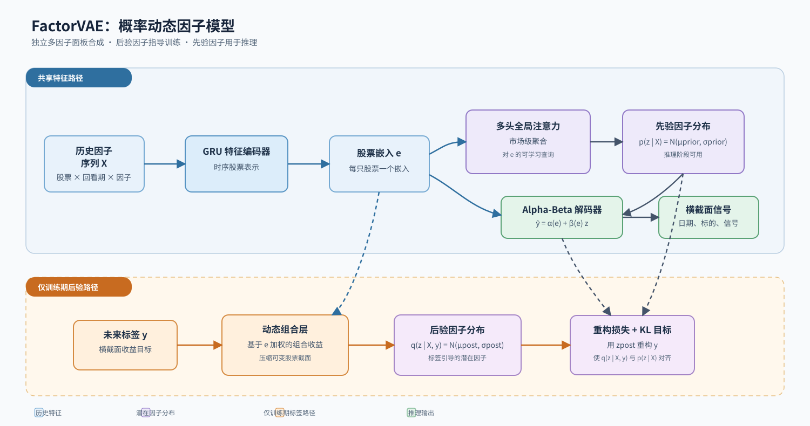

# FactorVAE Alpha Model

## 网络结构




`skill-factor-model-factorvae` 是一个独立、可安装的多因子合成模型。它从用户提供的因子面板中学习动态潜在因子，输出每个股票、每个日期的横截面预测信号。

## 功能

- 读取 CSV 或 Parquet 多因子面板；
- 使用历史因子序列构建股票表示；
- 在训练阶段以标签构造后验因子分布，并以历史特征构造先验因子分布；
- 使用 `alpha + beta × latent factor` 的概率解码器生成排序信号与预测不确定度；
- 按验证集平均 Pearson IC 选择 checkpoint；
- 导出标准 `date,ticker,signal` Parquet，不绑定任何特定回测系统。

## 安装与快速开始

```bash
python -m pip install -e ".[test]"
python examples/make_synthetic_panel.py   --output examples/generated/synthetic_panel.csv
python scripts/run_model.py check --config examples/smoke.yaml
python scripts/run_model.py train --config examples/smoke.yaml
```

训练命令会打印运行目录。随后导出测试区间信号并校验产物：

```bash
python scripts/run_model.py predict   --run-dir outputs/smoke/<run_id> --split test
python scripts/run_model.py verify   --run-dir outputs/smoke/<run_id>
```

运行合成数据冒烟测试和单元测试：

```bash
python scripts/run_smoke.py
python -m pytest -q
```

## 输入数据

输入是一张用户提供的长表，每行对应一个 `(date, ticker)`：

| 列 | 含义 |
|---|---|
| `date` | 整数日期，格式为 `YYYYMMDD` |
| `ticker` | 股票标识符 |
| `factor_*` | 一个或多个数值因子列 |
| `label` | 训练和验证标签；纯未来预测行可以为空 |

因子列与标签列必须在 YAML 中显式声明。示例配置：

```yaml
data:
  panel_path: /path/to/panel.parquet
  date_column: date
  ticker_column: ticker
  label_column: label
  feature_columns: [factor_value, factor_quality, factor_momentum]
splits:
  train: [20160104, 20231229]
  valid: [20240102, 20241231]
  test: [20250102, 20261231]
preprocessing:
  lookback: 20
model:
  hidden_size: 64
  latent_factors: 8
  portfolios: 16
training:
  epochs: 20
  learning_rate: 0.001
  seed: 42
```

完整字段说明见 [输入契约](references/input_contract.md)。

## 输出

每次训练在 `output_root/run_<timestamp>/` 下生成：

| 文件 | 内容 |
|---|---|
| `resolved_config.yaml` | 冻结后的实际配置 |
| `input_manifest.json` | 输入面板形状和特征列表 |
| `training_metrics.jsonl` | 每个 epoch 的训练与验证记录 |
| `best_checkpoint.pt` | 验证集 Pearson IC 最优 checkpoint |
| `validation_summary.json` | 最优 epoch 与验证指标 |
| `signals_<split>.parquet` | 导出的预测信号 |

信号文件固定为：

```text
date,ticker,signal
20250102,600000,0.1837
```

完整定义见 [输出契约](references/output_contract.md)。

## 方法与论文参考

本项目参考以下论文的先验-后验动态因子结构：

> Yitong Duan, Lei Wang, Qizhong Zhang, Jian Li. **FactorVAE: A Probabilistic Dynamic Factor Model Based on Variational Autoencoder for Predicting Cross-Sectional Stock Returns.** AAAI 2022, pp. 4468-4476. DOI: [10.1609/aaai.v36i4.20369](https://doi.org/10.1609/aaai.v36i4.20369).

这是一个**非官方独立复现与通用因子面板适配版本**，并非论文作者发布的官方实现。仓库保留了历史编码、动态组合、后验/先验因子分布、Gaussian alpha-beta 解码与 KL 约束等核心结构；数据集、标签期限、训练切分和超参数均由用户配置，因此不以复现论文的具体数值结果为目标。详细映射见 [论文映射说明](references/paper_mapping.md)。

## 研究使用说明

**数据来源**：运行时由用户提供多因子面板和标签；仓库仅包含合成样例。**假设与参数**：时间切分、标签、回看期、模型维度与训练参数均通过 YAML 明确配置。**限制与风险边界**：输出为横截面排序信号，不包含组合构建、交易执行或收益保证。该项目仅用于研究与教育，不构成任何投资建议。

## 许可证

本项目采用 [GPL-3.0-only](LICENSE) 许可证。
